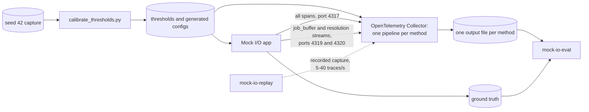

# CS-E4660: Investigating tracing

# 1. Research Questions

- Is it worth it to go deeper than OTel collector config options for trace processing
- Do simple reducers miss rare exceptions?
- Does a smarter reducer matter enough for finding exceptions and anomalies?
- Can an LLM keep up with reasonable costs?
- Application level vs. collector level adaptability?

# 2. Approach

The project compares trace reduction methods on one realistic, repeatable workload, scoring each by how much it keeps against whether it keeps what matters: the traces with errors and anomalies.

## Case study

Production traces have no ground truth: nobody knows which traces held the problem an operator would have needed. So the workload comes from a mock data platform, the [Mock I/O app](#case-study-app-mock-io-app), built on Dagster. The [supermarket scenario](#supermarket-scenario) has 49 jobs (importers, transformers, loaders) calling databases, cloud storage, HTTP APIs, and first- and third-party services, which gives traces of about 900 spans across many services. Each job runs in its own process, and runs overlap.

Problems are injected as labelled [anomalies](#anomalies): rare slow service calls, huge uploads, and outage windows, on top of a low background failure rate. Every injected anomaly is logged by trace and span ID, independently of what the collectors keep, so each method can be scored against what really happened. Outcomes are fixed by a seed, so the same workload can be replayed.

## Methods

The methods are grouped by where the reduction logic runs and how much it holds in memory, since that is what the research questions ask about:

| Group                                | Methods                                                                    | Holds                             |
| ------------------------------------ | -------------------------------------------------------------------------- | --------------------------------- |
| Reference                            | `baseline_naive`                                                           | nothing, keeps everything         |
| Stock collector, stateless           | `sampling` (10% of traces)                                                 | nothing                           |
| Stock collector, tail sampling       | `anomalies_sampling`, `anomalies_sampling_limited`, `routed_tail_sampling` | whole traces until a decision     |
| Collector with calibrated thresholds | `span_filter`                                                              | nothing                           |
| Application side                     | `job_buffer`, `resolution`                                                 | a running job's spans, or nothing |
| LLM agent                            | did not have time                                                          |                                   |

The stock collector methods use only OpenTelemetry Collector configuration. `span_filter` and `routed_tail_sampling` are still plain configuration, but generated from thresholds learned from a recorded baseline run (5× the median duration per service and span name, and per-job run durations). This separates what the collector can do from where its parameters come from. The application-side reducers run inside the app, where they know when a job has finished and need not guess how long to wait. All methods decide on observable signals only (errors and durations), never on the injected anomaly labels.

The method list grew from the results. The first experiments used the stock methods; tail sampling ran out of memory as the trace rate grew, so the later methods were designed to hold less or nothing ([Span-level and app-side methods](#span-level-and-app-side-methods)).

## Metrics

- **Reduction:** the share of traces, spans and bytes kept relative to the baseline.
- **Evidence:** the share of anomalous traces of which at least one span with an injected anomaly was kept. This is the main accuracy measure, because span-level methods keep a skeleton of every trace, so trace-level recall is near 100% for them by construction.
- **Recall by trace type:** anomalous, error, slow (at or above the baseline's 95th percentile duration) and normal traces, and per anomaly label. Recall on normal traces shows how much a method keeps without reason.
- **Cost:** peak collector memory, whether the collector was killed for running out of memory, and requests it refused, at increasing trace rates.

## Experimental design

- **Accuracy:** one app workload (260 runs, 10 iterations of the 26 leaf jobs, Poisson arrivals at 0.5 runs/s with up to 8 at once, real latencies) is fed to every collector at once, merged into one OpenTelemetry Collector, with the app-side reducers sending their streams in parallel. Trace IDs differ between runs, so this is the only way to compare methods on the same traces.
- **Out of sample:** thresholds are calibrated on seed 42 and evaluated on seeds 7 and 8.
- **Scale:** the app tops out at a few runs per second (Dagster's process startup), so a [replay tool](#benchmark-high-trace-rates) resends a recorded capture at 5 to 40 traces/s, with fresh IDs and matching ground truth, to each collector alone. App-side reducers cannot be measured this way, since the replay bypasses the app.

# 3. How

The test bench is written in Python (3.12, managed with uv): the app on Dagster with the OpenTelemetry SDK, and the methods as OpenTelemetry Collector (contrib) configs run in Docker. Commands are in the [Command reference](#command-reference).



## Calibration

`scripts/calibrate_thresholds.py` reads a `baseline_naive` capture of seed 42 and computes a latency threshold per service and span name (5× the median, for keys with at least 20 spans) and each job's run durations. It writes `thresholds/supermarket.json`, which the app-side reducers read, and generates the `span_filter` and `routed_tail_sampling` collector configs from it.

## Accuracy runs

1. Start one collector container with every method's config merged in. Each method has its own pipeline and output file, so they all see the same spans.
2. Run the app workload with a new seed (7 or 8), the ground truth log and the app-side reducers enabled. The app sends every span to the collector's main port, and the reducers send their reduced streams to their own ports, so the full export is unaffected.
3. Wait until the longest tail sampling hold has passed (200 s in run 3, for holds up to 90 s), then stop the collector so the last batches are written.
4. Score every output against the baseline output and the ground truth with `mock-io-eval`, which prints the recall matrix.

## Replay benchmark

The app cannot produce the trace rates where the methods differ in cost. Every run goes through Dagster, which takes seconds to start the job processes, so the app tops out at a few runs per second, while tail sampling's memory only becomes a problem from about 10 traces/s (killed at a 1 GB limit with a 60 s decision wait). Without a faster load generator the memory results could not have been measured.

`mock-io-replay` therefore skips the app and resends a recorded capture over OTLP at a target rate. Each copy of a trace gets new trace and span IDs and current timestamps, while its structure, durations, errors and anomaly labels are kept, and the ground truth is rewritten under the new IDs so the output can be scored as usual. With a fixed seed, every replay sends identical traces, so each collector runs alone (its memory measured with `docker stats`) and is scored against one baseline replay. `scripts/benchmark_rates.py` automates this for every collector at 5, 10, 20 and 40 traces/s.

The replay has caveats that limit what it can answer:

- **No application-side methods.** `job_buffer` and `resolution` run inside the app processes, and the replay bypasses the app, so they are not covered. The application versus collector comparison therefore rests on the accuracy runs at 0.5 runs/s only, and the application-side cost at high rates is unmeasured. Emulating the reducers in the replay would close this gap.
- **Traces arrive whole.** A replayed trace is sent in one request, while app spans arrive over the length of a run, so the plain tail samplers use a short decision wait (5 s in the latest benchmark) instead of the 120 s needed for app runs. Their memory at a realistic wait would be higher.
- **In-sample thresholds.** The replayed capture is the seed 42 run the thresholds were calibrated on, so evidence in the benchmark is optimistic. The accuracy runs give the out-of-sample figures.

4 result
linked to RQs

Initial hypotheses:

- **Naive sampling misses errors at its sampling rate.** Confirmed on average: `sampling` keeps about 10% of every trace type, anomalous or not. Rare anomaly types, with only a handful of traces each, scatter widely around that rate, and some are missed entirely (`slow_tax_service`: 0% in runs 1 and 2). Relates to "Do simple reducers miss rare exceptions?".
- **Tail sampling keeps anomalies, but its memory grows with the trace rate until it runs out.** Confirmed: `anomalies_sampling` keeps 100% evidence at low rates, but holds every trace until its decision, and was killed at 10 traces/s with a 1 GB limit, losing everything. Its fixed 1 s latency policy also matched almost every trace, so it barely reduced anything. Relates to "Does a smarter reducer matter enough?".

5 lesson

Problems faced

- Spent too long creating mock app
- - Mock app was too slow anyway
- - Replay made testing an agentic tracer more difficult

A proper compute cluster could have overcome the apps performance limitation, but the time budget did not allow to go deeper.

# Adaptive Tracing and Trace Reduction Test Bench

The goal of this project is to test and compare different adaptive tracing and trace reduction methods (for example sampling strategies and per-component tracing parameters). To get realistic, repeatable trace data, it is built on `mock-io-app`: a Dagster app whose jobs perform mocked I/O (database, GCS, HTTP and microservice calls) described by YAML scenarios. Every call emits OpenTelemetry spans, so the same workload can be replayed against different collectors and reduction methods.

- [Mock I/O app](#mock-io-app): the workload generator (implemented).
- [Collectors and reduction methods](#collectors-and-reduction-methods): the systems under test (baseline, fixed and tail sampling, span filtering, per-job routed tail sampling, app-side job buffering and adaptive resolution, and the evaluation harness exist; the LLM agent is pending).

# AI Usage

AI coding assistants (GitHub Copilot, using Claude models) were used extensively to implement this project's code, including the scenario model and validation, the executor and job factory, the API and clients, the scenario generator, the tests and this README. The author directed the work (requirements, design decisions and review of the results), and the generated code was checked with the automated test suite and sample runs.

# Case study app: Mock I/O app

## Setup

Requires Python 3.12+ and [uv](https://docs.astral.sh/uv/).

```sh
uv sync
uv run pytest
```

## Scenarios

Scenario files live in `scenarios/` (override with `MOCK_IO_SCENARIO_DIR` and `MOCK_IO_SCENARIO_GLOB`). The file name is the scenario name; jobs are exposed as `<scenario>__<job>`.

| File                       | Contents                                                                            |
| -------------------------- | ----------------------------------------------------------------------------------- |
| `small.yaml`, `mixed.yaml` | Small examples: sequential and gathered I/O, retries, copies, multiprocess executor |
| `microservices.yaml`       | First-party and third-party service calls                                           |
| `supermarket.yaml`         | 49-job supermarket data platform: importers, transformers, loaders (see below)      |
| `stress/stress.yaml`       | High-volume load, loaded only with `MOCK_IO_SCENARIO_DIR=scenarios/stress`          |

Structure of a scenario:

- `service_name` (optional): the `service.name` of the root `job.*` span and of ops in jobs without their own `service_name`; default is the process's name (e.g. `mock-io-cli`). A job's `service_name` sets the service of its own ops. Allowed characters: `a-z0-9_-`.
- `defaults`: `seed` (null for nondeterministic), `latency` (`fixed`, `normal`, `uniform`, `lognormal`), `failure_rate`.
- `jobs`: `name`, `copies`, `executor` (`in_process` or `multiprocess`), `depends_on` (base job names; upstream ops run first and are part of the job's run), and `ops`.
- `ops`: `name`, `retries`, and `call_groups`.
- `call_groups`: `io` + `action` (`db`: query/insert, `gcs`: upload/download/list, `http`: get/post, `service`: call), plus `count`, `mode` (`sequential` or `gather`), `max_concurrency`, `latency`, `failure_rate`, `payload_bytes`.
- YAML anchors and aliases are rejected; size limits are defined in `src/mock_io_app/scenario.py`.

### Anomalies

`anomalies` (on a call group, or on a service where it applies to every call of that service) injects labelled deviations into a random subset of calls, so there is ground truth for judging sampling and reduction methods:

```yaml
anomalies:
  - label: slow_tax_service # written to the span as `mock_io.anomaly`
    probability: 0.05 # chance per call (default 1.0)
    latency_multiplier: 8 # and/or latency_add_ms
    # fail: true                 # force a failure
    # payload_bytes: 8388608     # override the payload size
    # from_iteration: 5          # active for iterations in [from, to); `--repeat` / API `repeat` count iterations
    # to_iteration: 8
```

At least one effect is required. Several matching anomalies combine and their labels are comma-separated. Scenarios without anomalies behave exactly as before. The supermarket scenario defines (see `SERVICE_ANOMALIES` and `GROUP_ANOMALIES` in the generator):

| Label                                                       | Where            | Effect                                            | When           |
| ----------------------------------------------------------- | ---------------- | ------------------------------------------------- | -------------- |
| `slow_tax_service`, `slow_weather_api`, `slow_price_engine` | service calls    | 20-30x latency or +1.5 s                          | rare, random   |
| `huge_blob`                                                 | GCS uploads      | 8 MiB payload, 15x latency                        | rare, random   |
| `http_flap`                                                 | HTTP gets        | failures, triggering op retries and larger traces | iterations 3-4 |
| `email_outage`                                              | `email_provider` | failures with retries                             | iterations 7-8 |

Use `--repeat 10` or more to cover the windows. Latency anomalies are only visible in span durations if `--latency-scale` is not tiny (0.01 or higher).

#### Ground truth

The span attribute is lost if a collector drops the span, so for evaluation write an independent log:

- `MOCK_IO_GROUND_TRUTH_FILE=<path>`: appends one JSON line per anomalous call: `trace_id`, `span_id`, `span_name`, `call_index`, `anomalies`, `timestamp`. Join it to the reduced output on `trace_id` / `span_id`. Requires an enabled trace exporter (`console` or `otlp`), since the IDs come from the spans. Delete the file between experiments.
- `MOCK_IO_ANOMALY_ATTRIBUTE=0`: stop exporting `mock_io.anomaly`, so methods under test cannot see the labels (default: exported).

### Microservices

Top-level `services` declares callable services; call groups use `io: service`, `service: <name>`, `action: call`.

- `first_party`: defines its own `call_groups` (which may call other services). The call produces a client span, and the handler's work runs in a nested server span.
- `third_party`: a black box with no internals; only the client-side call span is traced. The call group's latency and failure rate model it.

### Supermarket scenario

Generated by `scripts/generate_supermarket.py` (seeded) into `scenarios/supermarket.yaml`:

- Traces use service name `supermarket-dag` for the root job span, and each job's ops use their own service name (the job name with `-`, e.g. `import-orders`).
- 10 importers (5-10 DB, HTTP and GCS ops each), running independently.
- 15 transformers plus 2 big ones, depending on combinations of importers.
- 20 loaders plus 2 big ones, depending on transformers and importers.
- Big jobs have 10x the steps. Transformers and loaders also call first- and third-party services.

Regenerate with `uv run python scripts/generate_supermarket.py`.

## Running

Run jobs from the command line, with no webserver. Runs use a throwaway Dagster instance and don't appear in the Dagster UI unless `DAGSTER_HOME` is set (use the same directory as `dagster dev`, see below). Without `--job`, only leaf jobs run since they include their upstream jobs.

```sh
uv run mock-io-run --scenario scenarios/small.yaml
uv run mock-io-run --scenario scenarios/supermarket.yaml --latency-scale 0.01
uv run mock-io-run --scenario scenarios/supermarket.yaml --job load_store_dashboards --latency-scale 0.01
```

`--seed N` overrides the scenario's `defaults.seed` for this run (the API takes `seed` in the launch body, `mock-io-ctl run-scenario --seed N`), so the same workload can be replayed exactly; see [Experiments](#experiments).

### Parallelism

Work overlaps at three levels:

| Level                 | What runs in parallel                                                      | Controlled by                                                               |
| --------------------- | -------------------------------------------------------------------------- | --------------------------------------------------------------------------- |
| Calls in a call group | the calls of a `mode: gather` group (asyncio)                              | `mode`, `max_concurrency` in the scenario                                   |
| Jobs in a run         | independent jobs (e.g. the importers under a loader) in separate processes | the job's `executor: multiprocess`, or `mock-io-run --executor`             |
| Runs                  | whole runs                                                                 | `mock-io-run` load mode (`--rate`, `--workers`), or `dagster dev` / the API |

`--executor` is `scenario` by default (each job's own `executor`; all supermarket jobs use `multiprocess`), or `in_process` / `multiprocess` for every job. The multiprocess executor starts each job in its own process, at most the CPU count at once (`DAGSTER_MULTIPROCESS_EXECUTOR_MAX_CONCURRENT` changes it). Use `--executor in_process` for a single process: faster to start, but jobs in a run execute one after another. Without `DAGSTER_HOME`, multiprocess runs use a temporary on-disk instance, since child processes cannot share an in-memory one. Under `dagster dev`, at most 10 runs execute at once (Dagster's default `max_concurrent_runs`).

Check what actually overlapped in a capture:

```sh
uv run python scripts/check_parallelism.py out/baseline_naive.jsonl
```

It prints the maximum number of runs at once, how many runs had overlapping jobs, and how many call groups had overlapping calls. A sequential capture shows `max running at once: 1` and `with overlapping jobs: 0`.

Repeated runs (`--repeat`) draw fresh latencies and failures each iteration; with a seed they are still reproducible (the iteration is part of the random key).

Load mode starts runs of randomly chosen jobs at Poisson arrival times instead of back to back, so runs and their traces overlap in time:

```sh
uv run mock-io-run --scenario scenarios/supermarket.yaml --rate 0.5 --runs 100 --workers 4 --latency-scale 0.05
```

`--rate` is the mean arrivals per second (enables load mode), `--runs` the total, `--workers` the maximum concurrent runs (arrivals queue when all are busy), `--seed` the seed for arrivals and job choice. Jobs are chosen from `--job` if given, otherwise from the leaf jobs. Every block of as many runs as there are candidate jobs counts as one iteration for anomaly windows, so `--runs` = iterations x jobs matches `--repeat` (supermarket has 26 leaf jobs: `--runs 260` covers iterations 0-9, like `--repeat 10`).

Dagster UI (`DAGSTER_HOME` must be set to a writable directory):

```sh
mkdir -p .dagster_home
DAGSTER_HOME="$PWD/.dagster_home" uv run dagster dev -p 3000
```

The UI is at <http://127.0.0.1:3000> (code location `mock_io_app`). Jobs are named `<scenario>__<job>`; start one from the job's Launchpad ("Launch run"). To export traces to Jaeger, set the tracing variables (see [Emitted traces](#emitted-traces)) in the same shell before starting `dagster dev`, e.g. `MOCK_IO_TRACE_EXPORTER=otlp`.

HTTP API and client:

```sh
uv run mock-io-api                      # MOCK_IO_API_HOST / MOCK_IO_API_PORT, default 127.0.0.1:8000
uv run mock-io-ctl scenarios
uv run mock-io-ctl run-scenario mixed --repeat 3 --wait
uv run mock-io-ctl upload my_scenario my_scenario.yaml
```

Everything a launch request starts is part of that request's trace: the API creates one `run.<job>` span per launched run (`repeat` times per job) under the request span (or under the caller's `traceparent`), and the Dagster run continues from it. The `run.*` span covers only the submission, so the `job.*` spans appear after it in the same trace.

## Emitted traces

`MOCK_IO_TRACE_EXPORTER` selects the exporter: `none` (default), `console` or `otlp`. For `otlp`, the standard `OTEL_EXPORTER_OTLP_*` variables apply, and `OTEL_SERVICE_NAME` overrides the service name. Trace context is propagated from the API or CLI into Dagster runs through run tags.

### Local Jaeger

Run Jaeger all-in-one with Docker (OTLP gRPC on 4317, OTLP HTTP on 4318, UI on 16686):

```sh
docker run --rm --name jaeger \
  -p 16686:16686 -p 4317:4317 -p 4318:4318 \
  jaegertracing/jaeger:latest
```

Point the app at it (these are the defaults in `.env`):

```sh
export MOCK_IO_TRACE_EXPORTER=otlp
export OTEL_EXPORTER_OTLP_ENDPOINT=http://127.0.0.1:4317
export OTEL_EXPORTER_OTLP_PROTOCOL=grpc
uv run mock-io-run --scenario scenarios/small.yaml
```

To run Jaeger together with the experiment collectors (which also need 4317/4318), see [Jaeger next to the collectors](#experiments). To use OTLP over HTTP instead, set `OTEL_EXPORTER_OTLP_PROTOCOL=http/protobuf` and `OTEL_EXPORTER_OTLP_ENDPOINT=http://127.0.0.1:4318`. Browse traces at <http://127.0.0.1:16686>.

Span layout: `run.<job>` (one per run, created by the CLI or by the API when it launches a run; scenario `service_name`) > `job.<job>` (one per job in the run, in that job's service; upstream jobs get their own) > `op.<name>` > `call_group.<io>.<action>` > `<io>.<action>` (client span per call). Each job is one Dagster op (so the Dagster graph mirrors the job DAG, and independent jobs can run in parallel with the multiprocess executor); its scenario ops run in order inside the job, and `retries` re-run an op inside the job span (one `op.<name>` span per attempt, `dagster.retry_number`). Service calls produce `service.<name>.call` (client) and, for first-party services, a nested `service.<name>.handle` (server). The handle span and everything under it are exported with `service.name` set to the first-party service's name, so Jaeger shows them as separate services; third-party calls only appear as client spans of the caller.

## Layout

```
src/mock_io_app/
  scenario.py       scenario models, validation, job expansion
  executor.py       runs call groups (sequential/gather, service handlers)
  job_factory.py    builds Dagster jobs and ops from scenarios
  resources/        fake db, gcs, http, service clients
  tracing.py        OpenTelemetry setup and context propagation
  app_reducers.py   app-side reducers (job_buffer, resolution), MOCK_IO_APP_REDUCERS
  api/              FastAPI app, Dagster gateway, mock-io-ctl client
  evaluation.py     mock-io-eval: scores collector output against the baseline capture
  replay.py         mock-io-replay: resends a recorded capture at high rates (benchmark)
collectors/         collector configs (one directory per method; span_filter and routed_tail_sampling are generated)
thresholds/         calibrated latency thresholds (scripts/calibrate_thresholds.py)
scenarios/          bundled scenarios
scripts/            scenario generator, collector runner, parallelism check, calibration, rate benchmark
tests/
```

# Collectors and reduction methods

Implemented so far: the baseline, fixed sampling, tail sampling (plain, memory-capped and routed per job), a calibrated span filter, two app-side reducers (job buffering and adaptive resolution), and the evaluation loop they are measured with. The LLM agent is pending.

## Experiments

An experiment runs one fixed workload through a collector and scores what the collector kept.

1. **Fixed workload.** Outcomes (latencies, failures, anomalies) are fixed by the seed, either the scenario's `defaults.seed` or the run-level `--seed` (CLI) / `seed` (API). Trace and span IDs and timings are new every run, so methods are never compared across runs: run all collectors side by side on one workload run, and repeat with other seeds for more samples.
2. **Reference: `baseline_naive`** ([collectors/baseline_naive/config.yaml](collectors/baseline_naive/config.yaml)). An OpenTelemetry Collector that keeps every span and writes it to `out/baseline_naive.jsonl` (OTLP JSON lines). It is the "no reduction" baseline and the reference capture for scoring.
3. **Ground truth.** `MOCK_IO_GROUND_TRUTH_FILE` records every injected anomaly (see [Ground truth](#ground-truth)). `mock-io-eval` turns it into per-trace labels: anomalous (with the label names), error (any span with error status in the reference), and slow (duration at or above the reference's 95th percentile, `--slow-percentile`).
4. **Score.** `mock-io-eval --reference out/baseline_naive.jsonl --output out/<method>.jsonl --ground-truth ground_truth.jsonl` prints:
   - reduction: traces, spans and bytes kept relative to the reference, and mean trace completeness (share of a kept trace's spans that survived);
   - recall for anomalous, error, slow and normal traces, plus recall per anomaly label;
   - precision: the share of kept traces that are anomalous.
   - evidence: the share of anomalous traces of which at least one span an anomaly was injected into was kept. Trace recall counts a trace as kept if any of its spans is, so span-level methods (which keep every trace's skeleton) score about 100% there; evidence shows whether they kept what matters.
     With several `--output` flags, or `--output-dir out` (every `*.jsonl` there except the reference and the ground-truth file), it prints a recall matrix instead: one row per method, columns for traces/spans/bytes kept, evidence and the recall of each trace type (anomalous, error, slow, normal, each anomaly label). Add `--json` for machine-readable output. Output traces that are not in the reference are ignored.

A new method is a new `collectors/<method>/config.yaml` with its own `file/<method>` exporter (path `/out/<method>.jsonl`) and `traces/<method>` pipeline, so it can be merged with the others. Add it to the script's arguments and score it against the baseline capture.

Run the baseline (ports 4317/4318 must be free, so stop local Jaeger first or point Jaeger elsewhere):

```sh
bash scripts/run_collector.sh baseline_naive sampling anomalies_sampling anomalies_sampling_limited   # or: all
```

The script runs the named `collectors/<name>/config.yaml` files in one OpenTelemetry Collector (contrib) Docker image. The configs are merged, so a single workload feeds every collector and each writes `out/<name>.jsonl`. This is what makes scoring valid: all methods and the baseline see exactly the same traces, since trace IDs differ between runs. Always include `baseline_naive`.

| Collector                    | Behaviour                                                                                                                                                                                                                                                                            |
| ---------------------------- | ------------------------------------------------------------------------------------------------------------------------------------------------------------------------------------------------------------------------------------------------------------------------------------ |
| `baseline_naive`             | keeps every span (the reference)                                                                                                                                                                                                                                                     |
| `sampling`                   | `probabilistic_sampler`: keeps 10% of traces by trace ID, blind to errors and latency                                                                                                                                                                                                |
| `jaeger`                     | forwards every trace to Jaeger on host port 14317 (browsing only, writes no file)                                                                                                                                                                                                    |
| `anomalies_sampling`         | `tail_sampling`: keeps a trace if it has an error, lasts over 1000 ms, or wins a 5% random sample; uses only observable signals, never the `mock_io.anomaly` label                                                                                                                   |
| `anomalies_sampling_limited` | `anomalies_sampling` with `num_traces: 30`: simulates memory pressure. When more traces are waiting for a decision than that, the oldest is dropped without one                                                                                                                      |
| `span_filter`                | `filter` (stateless): drops detail spans faster than their calibrated threshold that are not errors; keeps the skeleton (`run.`/`job.`/`op.`), spans without a threshold, and 1% of whole traces. Generated, see [Span-level and app-side methods](#span-level-and-app-side-methods) |
| `routed_tail_sampling`       | `routing` connector + one `tail_sampling` per hold time: spans go by `mock_io.run_job` to a sampler whose `decision_wait` fits that job (45-90 s for supermarket); keeps errors, runs slower than 1.5× their job's median, 1% random. Generated                                      |
| `app_job_buffer`             | receives the app's `job_buffer` stream on port 4319 and writes it unchanged                                                                                                                                                                                                          |
| `app_resolution`             | receives the app's `resolution` stream on port 4320 and writes it unchanged                                                                                                                                                                                                          |

Tail sampling decides `decision_wait` (120 s; supermarket runs at `--latency-scale 1` take up to about 40 s) after a trace's first span, so it must exceed the longest run, and the collector must keep running for that long after the workload ends. Thresholds and rates are starting points to tune per experiment.

**Memory pressure.** Tail sampling holds every span of a trace in memory until its decision, so it holds about runs/s × `decision_wait` traces at once (0.5 × 120 = 60 in the default experiment). `anomalies_sampling_limited` caps that at 30 traces, so it drops traces at that rate; raise `--rate` to see recall fall further. The cap is per processor, so the other collectors in the same container are unaffected. This depends only on the trace count, unlike the collector's `memory_limiter`, which refuses data for the whole process (the baseline included) based on measured memory. Processors are merged by name across configs, so each collector's tail sampler has its own name (`tail_sampling/<name>`).

### Span-level and app-side methods

Tail sampling turned out to be a dead end at higher rates: it holds every span for `decision_wait`, so memory grows with rate × wait and an OOM loses everything (see PROJECT.md). These methods avoid holding whole traces in the collector:

- **Calibration.** `scripts/calibrate_thresholds.py` reads a `baseline_naive` capture and computes a latency threshold per (`service.name`, span name): 5× the median duration (`--factor`; the median is barely moved by injected anomalies, unlike p99), for keys with at least 20 spans. It also takes each job's run durations. It writes `thresholds/supermarket.json` and regenerates `collectors/span_filter/config.yaml` and `collectors/routed_tail_sampling/config.yaml`; rerun it instead of editing those. Calibrate on a different seed than you evaluate on, or the thresholds have seen the test data.
- **`span_filter`** (collector, stateless): no memory per trace. Ancestors of slow or failed spans are usually kept too, since they are slow or failed themselves.
- **`routed_tail_sampling`** (collector): a hold time per job instead of one for all. The app tags every span with `mock_io.run_job` (the job being run) so the `routing` connector can route spans, not only whole traces. Spans without it (old captures, API request spans) go to a 120 s default; `mock-io-replay` adds it to old captures from their `run.*` span. An API request that launches several jobs has one trace whose spans split across samplers.
- **App-side reducers** (`src/mock_io_app/app_reducers.py`) run in the app next to the full export (shadow mode), each sending its reduced stream to its own collector port, so the baseline still gets everything:
  - `job_buffer`: buffers the spans of each local trace part (a job's spans in its process, or the CLI's `run.*` span) until its root ends, then sends all of them if any errored or was slow, or the trace wins a 5% sample (`MOCK_IO_JOB_BUFFER_SAMPLE_RATE`; decided from the trace ID, so all processes agree), and drops them otherwise. Memory is bounded by the jobs currently running, and it knows when a job is done instead of waiting. Parts are decided separately, so kept traces can be partial.
  - `resolution`: no buffering. Sends the skeleton always, and a detail span if it errored, was slow, has no threshold, or has a sent descendant (children end before their parents, so the path up to an interesting span is kept).

  Enable them with `MOCK_IO_APP_REDUCERS=job_buffer,resolution` and `MOCK_IO_THRESHOLDS=thresholds/supermarket.json` (endpoints `MOCK_IO_JOB_BUFFER_ENDPOINT`, default `localhost:4319`, and `MOCK_IO_RESOLUTION_ENDPOINT`, `localhost:4320`), and run the `app_job_buffer` and `app_resolution` collectors; `run_collector.sh` publishes their ports. Their cost is in the app processes, so `mock-io-replay` and the rate benchmark (which bypass the app) cannot measure them.

**Jaeger alongside the collectors.** The `jaeger` collector forwards every trace to a local Jaeger, so you can browse traces while the experiment runs. The app sends to the collector on 4317, so move Jaeger's OTLP port to 14317:

```sh
docker run --rm --name jaeger -p 16686:16686 -p 14317:4317 jaegertracing/jaeger:latest
bash scripts/run_collector.sh all   # includes jaeger; leave it out if Jaeger is not running
```

The app settings stay the same (`OTEL_EXPORTER_OTLP_ENDPOINT=http://127.0.0.1:4317`); UI at <http://127.0.0.1:16686>. The collector container reaches Jaeger through `host.docker.internal`.

Stop the collector (Ctrl-C) before scoring so the final batch is flushed. Delete `out/*.jsonl` and the ground-truth file between experiments. The collector config and docker command are untested in the development sandbox, which has no Docker.

## Benchmark: high trace rates

The app cannot test how reducers hold up at high rates: each run goes through Dagster, and starting the job processes alone takes seconds, so the app is the bottleneck long before the collector. Two load generators skip the app:

- **`mock-io-replay`** resends a recorded capture (a `baseline_naive.jsonl` and its ground truth) over OTLP gRPC at a target rate. Each copy of a trace gets new trace and span IDs and is shifted to end at send time, so structure, latencies, errors and anomaly labels are kept. With `--ground-truth-out` it writes the ground truth under the new IDs, so `mock-io-eval` scores a replayed workload like a recorded one, against the `baseline_naive` capture of the replay. It cycles through the capture's traces in recorded order (`--shuffle --seed N` for a random order) until `--traces` are sent. `--rate` is traces/s overall (default: as fast as possible), `--workers` concurrent senders and `--batch` traces per request. It prints the achieved traces/s and spans/s, and counts requests the collector refused (for example under `memory_limiter`); those are not retried and not written to the ground truth. Generating copies runs at about 300k spans/s on a laptop, so the collector should be the limit; loading a large capture takes a while (about 35 s for 450k spans).
- **[telemetrygen](https://github.com/open-telemetry/opentelemetry-collector-contrib/tree/main/cmd/telemetrygen)**, the OpenTelemetry Collector's load generator, sends identical synthetic traces (`--child-spans` per trace, `--rate` traces/s per worker). It has no errors, anomalies or ground truth, so it only measures raw throughput: where a collector starts refusing or dropping data.

Copy the recorded capture out of `out/` first: the replay's collectors write to `out/` again. Supermarket traces are large (about 900 spans each), so a few hundred traces/s is already hundreds of thousands of spans/s. Watch the collector's memory with `docker stats otelcol`.

Tail sampling holds every span until its decision, about spans/s × `decision_wait`. At 20 traces/s (about 17,500 spans/s) with the default 120 s, that is about 2 million spans, and Docker kills the collector (exit code 137): its output stops, the replay reports `UNAVAILABLE`, and the tail samplers write nothing. Replayed traces arrive whole in one request, so start the collectors with a short wait for replays: `DECISION_WAIT=5s bash scripts/run_collector.sh ...` (`run_collector.sh` passes `DECISION_WAIT`, default `120s`, to both tail samplers). Keep the default for app runs, whose spans arrive over the length of the run.

**One collector at a time.** All merged collectors share one process, so one method running out of memory or CPU takes the others (and the baseline) down with it, and `docker stats` cannot tell their costs apart. With `--seed`, a replay's trace and span IDs depend only on the seed and the trace's position, so replays with the same arguments send identical traces and ground truth. Capture `baseline_naive` once, then replay the same command against each method alone and score each output against that one baseline. Only arrival timing differs between replays; trace durations come from the recording. App runs (`mock-io-run`) cannot do this, since their IDs are random, so they need the merged collector. The file exporter appends, so delete a method's `out/<method>.jsonl` before replaying it again.

# Command reference

All commands run from the repository root.

## Setup

```sh
uv sync
uv run pytest

# Local Jaeger (UI http://127.0.0.1:16686). Standalone: use -p 4317:4317 -p 4318:4318 instead of 14317.
# Next to the collectors it must use 14317, as here, because the collectors own 4317.
docker run --rm --name jaeger -p 16686:16686 -p 14317:4317 jaegertracing/jaeger:latest

# Export traces to it (set in every shell that runs the app, including `dagster dev`)
export MOCK_IO_TRACE_EXPORTER=otlp OTEL_EXPORTER_OTLP_ENDPOINT=http://127.0.0.1:4317 OTEL_EXPORTER_OTLP_PROTOCOL=grpc

# Optional evaluation helpers
export MOCK_IO_GROUND_TRUTH_FILE=ground_truth.jsonl   # anomaly log
export MOCK_IO_ANOMALY_ATTRIBUTE=0                    # hide labels from spans

# Regenerate the supermarket scenario
uv run python scripts/generate_supermarket.py
```

## Ways to run

```sh
# 1. CLI (no webserver); jobs use the scenario's executor (supermarket: multiprocess)
uv run mock-io-run --scenario scenarios/small.yaml
uv run mock-io-run --scenario scenarios/supermarket.yaml --executor in_process   # single process
uv run mock-io-run --scenario scenarios/supermarket.yaml --latency-scale 0.01 --repeat 10
uv run mock-io-run --scenario scenarios/supermarket.yaml --job load_store_dashboards --latency-scale 0.01

# 2. CLI load mode (Poisson arrivals, overlapping runs)
uv run mock-io-run --scenario scenarios/supermarket.yaml --rate 0.5 --runs 100 --workers 4 --latency-scale 0.05

# Check what ran in parallel in a capture
uv run python scripts/check_parallelism.py out/baseline_naive.jsonl

# 3. Dagster UI (http://127.0.0.1:3000); launch runs from the Launchpad
mkdir -p .dagster_home
DAGSTER_HOME="$PWD/.dagster_home" uv run dagster dev -p 3000

# 4. CLI runs visible in the Dagster UI (same DAGSTER_HOME as above)
DAGSTER_HOME="$PWD/.dagster_home" uv run mock-io-run --scenario scenarios/small.yaml

# 5. HTTP API (needs `dagster dev` running) and client
uv run mock-io-api
uv run mock-io-ctl scenarios
uv run mock-io-ctl run-scenario mixed --repeat 3 --wait
uv run mock-io-ctl upload my_scenario my_scenario.yaml
```

## Experiment

```sh
# Once per calibration capture (a different seed than the experiment): thresholds for span_filter,
# routed_tail_sampling and the app reducers
uv run python scripts/calibrate_thresholds.py \
  --capture captures/supermarket_seed42/baseline_naive.jsonl --out thresholds/supermarket.json
# Optional: check the generated collector configs
docker run --rm -v "$PWD/collectors:/c:ro" otel/opentelemetry-collector-contrib:latest validate \
  --config=/c/span_filter/config.yaml --config=/c/routed_tail_sampling/config.yaml

# Terminal 1: collectors (baseline plus methods, see Experiments); leave running
rm -rf out ground_truth.jsonl
bash scripts/run_collector.sh baseline_naive sampling anomalies_sampling anomalies_sampling_limited \
  span_filter routed_tail_sampling app_job_buffer app_resolution   # or: all (needs Jaeger on 14317)

# Optional, terminal 2: Dagster UI to watch the runs (http://127.0.0.1:3000)
mkdir -p .dagster_home
DAGSTER_HOME="$PWD/.dagster_home" uv run dagster dev -p 3000

# Terminal 3: fixed workload, with ground truth. Load mode: overlapping runs (--workers at once),
# each with parallel jobs (multiprocess). 260 runs = 10 iterations of the 26 leaf jobs, so all
# anomaly windows are covered. DAGSTER_HOME makes the runs show up in the Dagster UI; omit it to
# use a temporary instance instead.
# MOCK_IO_APP_REDUCERS adds the app-side reducers' streams (to app_job_buffer / app_resolution).
DAGSTER_HOME="$PWD/.dagster_home" MOCK_IO_TRACE_EXPORTER=otlp MOCK_IO_GROUND_TRUTH_FILE=ground_truth.jsonl \
  MOCK_IO_APP_REDUCERS=job_buffer,resolution MOCK_IO_THRESHOLDS=thresholds/supermarket.json \
  uv run mock-io-run --scenario scenarios/supermarket.yaml --latency-scale 1 \
  --rate 0.5 --runs 260 --workers 8 --seed 7

# Wait about 2 minutes after the workload ends (anomalies_sampling's decision_wait), then stop the
# collector in terminal 1 (Ctrl-C) so the final batch is flushed.

# Check that runs and jobs overlapped
uv run python scripts/check_parallelism.py out/baseline_naive.jsonl

# Score all methods at once as a recall matrix
uv run mock-io-eval --reference out/baseline_naive.jsonl --output-dir out --ground-truth ground_truth.jsonl
# One method in detail (--output out/sampling.jsonl etc.); the baseline against itself is a sanity check (100%)
uv run mock-io-eval --reference out/baseline_naive.jsonl --output out/anomalies_sampling.jsonl \
  --ground-truth ground_truth.jsonl
```

## Benchmark: increasing rates

`scripts/benchmark_rates.py` runs each collector alone in Docker at each rate, replaying one seeded capture (see [Benchmark: high trace rates](#benchmark-high-trace-rates)). `baseline_naive` runs first at every rate and is the reference for that rate. Tail sampling uses a 5 s `decision_wait` (`--decision-wait`), since replayed traces arrive whole; `routed_tail_sampling` keeps its calibrated per-job waits (the replay waits for the longest). Collectors are stopped with SIGTERM so the final batch is flushed. Per run it prints the achieved traces/s, refused requests, peak container memory (`docker stats`), whether Docker killed the collector (OOM), traces and spans kept, evidence and recall by trace type, and writes everything to `bench/results.json`.

```sh
uv run python scripts/benchmark_rates.py \
  --capture captures/supermarket_seed42/baseline_naive.jsonl \
  --ground-truth captures/supermarket_seed42/ground_truth.jsonl \
  --rates 5,10,20,40 --duration 30
# Options: --collectors NAME... (default: baseline_naive sampling anomalies_sampling
#            anomalies_sampling_limited span_filter routed_tail_sampling),
#          --memory 512m (Docker memory limit per collector, to reach OOM at lower rates),
#          --traces N (fixed size instead of rate x duration), --keep (keep the large outputs in bench/)
```

Ports 4317 must be free (stop other collectors). Each run sends `rate × duration` traces of about 900 spans, so the baseline output is about 1 MB per trace; outputs are deleted after scoring unless `--keep`. Loading the capture takes about 35 s.

## Benchmark

```sh
# Keep a recorded capture (an Experiment run, here with --seed 42) as the replay source; name it after its seed
mkdir -p captures/supermarket_seed42
cp out/baseline_naive.jsonl ground_truth.jsonl captures/supermarket_seed42/

# Terminal 1: fresh collectors. Replayed traces arrive whole, so a short decision_wait is enough;
# with the default 120s, tail sampling holds 120s of spans and the collector runs out of memory.
rm -rf out
DECISION_WAIT=5s bash scripts/run_collector.sh baseline_naive sampling anomalies_sampling anomalies_sampling_limited

# Terminal 2: replay 2000 traces at 20 traces/s, then score as in the Experiment
uv run mock-io-replay --capture captures/supermarket_seed42/baseline_naive.jsonl \
  --ground-truth captures/supermarket_seed42/ground_truth.jsonl --ground-truth-out out/replay_ground_truth.jsonl \
  --traces 2000 --rate 20 --workers 8 --batch 5
# Wait for decision_wait (a few seconds), stop the collector (Ctrl-C), then:
uv run mock-io-eval --reference out/baseline_naive.jsonl --output-dir out --ground-truth out/replay_ground_truth.jsonl

# Or one collector at a time (isolated memory/CPU, docker stats per method): same --seed every time
REPLAY="uv run mock-io-replay --capture captures/supermarket_seed42/baseline_naive.jsonl \
  --ground-truth captures/supermarket_seed42/ground_truth.jsonl --traces 2000 --rate 20 --workers 8 --batch 5 --seed 1"
rm -rf out
DECISION_WAIT=5s bash scripts/run_collector.sh baseline_naive   # terminal 1; Ctrl-C after the replay
$REPLAY --ground-truth-out out/replay_ground_truth.jsonl        # terminal 2
DECISION_WAIT=5s bash scripts/run_collector.sh anomalies_sampling   # then each method in turn
$REPLAY
uv run mock-io-eval --reference out/baseline_naive.jsonl --output-dir out --ground-truth out/replay_ground_truth.jsonl

# Raw throughput with synthetic traces (no ground truth): 4 workers x 250 traces/s, 10 spans each
docker run --rm --add-host=host.docker.internal:host-gateway \
  ghcr.io/open-telemetry/opentelemetry-collector-contrib/telemetrygen:latest \
  traces --otlp-insecure --otlp-endpoint host.docker.internal:4317 \
  --workers 4 --rate 250 --child-spans 9 --duration 60s
```
